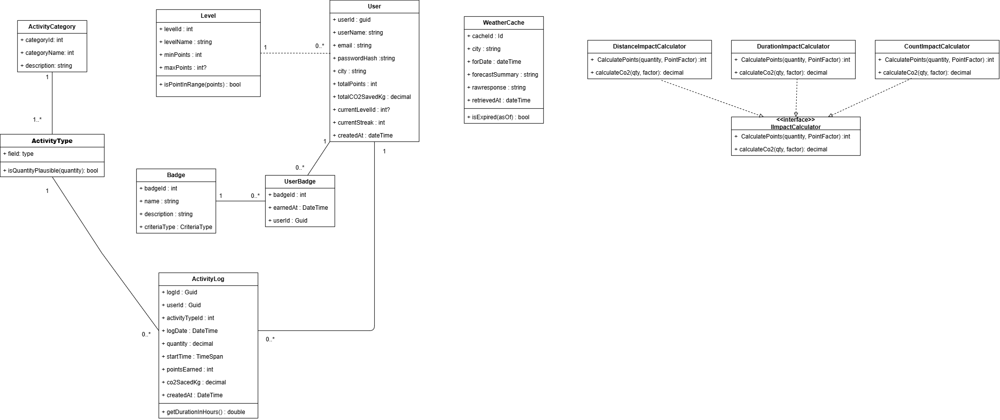
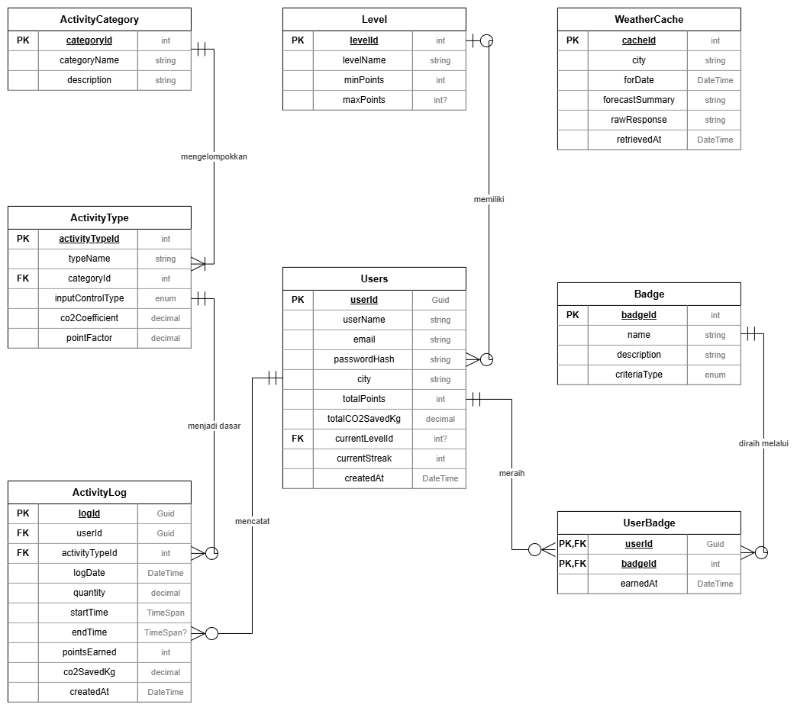

# ecoQuest
Aplikasi desktop (WPF, .NET 8) untuk memantau jejak karbon harian dengan pendekatan gamifikasi: catat aktivitas, lakukan *evening review*, kumpulkan pencapaian, dan bersaing di leaderboard.

## Fitur Utama

- **Autentikasi**: daftar, masuk, onboarding, dan keluar (password di-hash dengan BCrypt).
- **Beranda**: ringkasan jejak karbon harian, insight, dan cuaca besok berdasarkan domisili (AccuWeather via Supabase Edge Function).
- **Evening Review**: pencatatan aktivitas harian dan perhitungan emisi.
- **Riwayat**: daftar riwayat review, termasuk ekspor CSV.
- **Pencapaian**: badge yang terbuka sesuai capaian pengguna.
- **Leaderboard**: peringkat antar pengguna.
- **Profil**: data akun, foto profil, dan ganti password.

## Teknologi

| Komponen | Teknologi |
|---|---|
| Aplikasi | C# WPF, .NET 8 (`net8.0-windows`) |
| Arsitektur | MVVM (CommunityToolkit.Mvvm), Dependency Injection (Microsoft.Extensions.DependencyInjection) |
| Backend | Supabase (`supabase-csharp`): PostgreSQL, RPC, Edge Function |
| Keamanan password | BCrypt.Net-Next |
| Grafik | LiveCharts2 (SkiaSharp, WPF) |
| Layanan cuaca | AccuWeather API, diakses lewat Edge Function |
| Pengujian | xUnit, NSubstitute |

## Arsitektur Singkat

```
Views → ViewModels → Core/Contracts ← Services → Data → Supabase
```

- **Views / ViewModels**: tampilan XAML dan logika presentasi (MVVM).
- **Core**: aturan bisnis murni (`Calculation`, `Domain`, `Rules`, `Validation`, `Contracts`, `Common`) tanpa ketergantungan ke UI maupun jaringan.
- **Services**: orkestrasi use case (auth, review, riwayat, dst.).
- **Data**: repository, record, mapping, dan pemanggilan RPC ke Supabase.
- **Infrastructure**: konfigurasi (`AppConfig`), hashing, logging.

## Struktur Folder

```
ecoQuest/
├── Controls/ Converters/ Navigation/ Resources/ Selectors/   # UI pendukung
├── Views/ ViewModels/                                        # Lapisan presentasi
├── Core/        # Calculation, Common, Contracts, Domain, Rules, Validation
├── Services/    # Logika aplikasi
├── Data/        # Errors, Mapping, Records, Repositories, Rpc
├── Infrastructure/
├── EcoQuest.Tests/        # Unit & integration test
├── database/              # migrations/ dan seed/
├── supabase/functions/    # Edge Function weather-tomorrow
└── docs/                  # class-diagram/, erd/
```

## Menjalankan Aplikasi

### A. Dari paket `.exe` (disarankan untuk pengujian)

1. Ekstrak seluruh isi zip ke satu folder (`EcoQuest.exe`, `.env`, dan folder `Resources`).
2. Pastikan file `.env` berada di folder yang sama dengan `EcoQuest.exe`.
3. Jalankan `EcoQuest.exe`, lalu daftar dengan akun baru.

Tidak perlu menginstal .NET (paket *self-contained*, Windows x64).

### B. Dari source code

Prasyarat: Windows, [.NET 8 SDK](https://dotnet.microsoft.com/download/dotnet/8.0).

```bash
git clone https://github.com/shafiyahnuril/ecoQuest.git
cd ecoQuest
copy .env.example .env     # lalu isi nilainya (lihat di bawah)
dotnet build
dotnet run --project ecoQuest.csproj
```

### Konfigurasi `.env`

| Variabel | Keterangan |
|---|---|
| `SUPABASE_URL` | URL project Supabase |
| `SUPABASE_KEY` | **Anon key** Supabase |
| `ECOQUEST_USE_FAKES` | `false` = terhubung ke Supabase (mode nyata). `true` = data demo lokal tanpa jaringan |

Jika `ECOQUEST_USE_FAKES=false` tetapi URL/key kosong, aplikasi menampilkan layar *ConnectionError*.


## Pengaturan Basis Data

1. Buat project Supabase.
2. Jalankan skrip SQL di `database/migrations/` secara berurutan lewat SQL Editor.
3. (Opsional) Isi data awal dari `database/seed/`.
4. Deploy Edge Function cuaca dan set secret-nya:

```bash
supabase secrets set ACCUWEATHER_API_KEY=<isi_key_anda>
supabase functions deploy weather-tomorrow
```

Key AccuWeather hanya disimpan sebagai secret di Edge Function, tidak pernah di aplikasi klien.

## Pengujian

```bash
dotnet test
```

Mencakup perhitungan emisi, validasi, aturan bisnis, service, ViewModel, hashing, dan skenario data demo.


## Diagram

**Class Diagram**



**ERD**



## Tim — Kelompok Warung Iklim

| Nama | NIM | Peran |
|---|---|---|
| Shafiyah Nuril Hayya | 24/540586/TK/60019 | Ketua |
| Aurelia Mutiah Raudyatuzzahra | 24/534903/TK/59310 | Anggota |
| Bagas Adjie Pamungkas | 24/544718/TK/60547 | Anggota |
| Alya Luqyana Nasywa | 24/545645/TK/60716 | Anggota |
